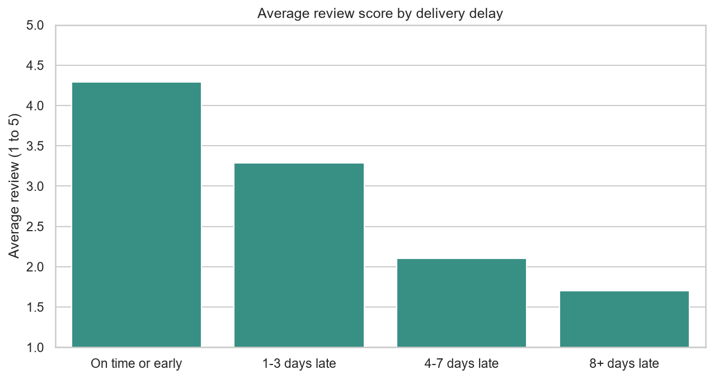

# Olist E-commerce Performance and Customer Behavior Analysis

SQL + Python analysis of ~96K delivered orders from a Brazilian online marketplace
(2016-2018): revenue trends, delivery performance, review scores, and repeat purchasing.

## Business Problem
Leadership wants to know what drives revenue, whether late deliveries hurt customer
reviews, and why most customers buy only once.

## Key Findings
- **Revenue:** Jan-Aug 2018 revenue was X% higher than Jan-Aug 2017.
- **Retention:** only X% of customers ordered more than once, so growth is driven by new customers.
- **Delivery:** X% of orders arrived late. Late orders average X stars vs Y for on-time orders, and 8+ days late drops to Z.
- **Geography:** [State] has the highest late-delivery rate at X%.
- **Segments:** repeat customers are X% of customers but X% of revenue.

## Recommendations
1. **Fix delivery in [worst states]:** partner with regional carriers or set realistic delivery estimates at checkout.
2. **Run a second-purchase campaign** 30 to 60 days after the first order.
3. **Protect high-value segments** with early access or loyalty offers.

## Dataset
Brazilian E-Commerce Public Dataset by Olist (Kaggle), 9 related tables, 2016-2018.
Raw files are not included. Download them from Kaggle into `data/raw/`.

## Approach
1. Loaded 8 tables into MySQL with Python (`src/load_data.py`)
2. Cleaned and validated the data, and built one row per delivered order (`notebooks/01`)
3. Answered 6 business questions in SQL: CTEs, window functions, cohort retention (`sql/02`)
4. Explored and visualized the results in pandas, matplotlib, and seaborn (`notebooks/02`, `03`)
5. Segmented customers with RFM (`notebooks/04`)

## Key Decisions
- Used only `delivered` orders for revenue and delivery metrics (X orders excluded).
- Used `customer_unique_id` (not `customer_id`) to identify real customers.
- Kept the latest review per order to avoid duplicating rows in joins.
- Aggregated items before joining, with assertions checking no rows were duplicated.

## Tech Stack
Python (pandas, SQLAlchemy, matplotlib, seaborn), MySQL 8, Jupyter, Git

## How to Run
1. `pip install -r requirements.txt`
2. Create the database: `CREATE DATABASE olist CHARACTER SET utf8mb4;`
3. Copy `.env.example` to `.env` and add your MySQL password
4. Put the Olist CSV files in `data/raw/`
5. `python src/load_data.py`, then run `sql/01_schema_setup.sql`
6. Run the notebooks in order (01 to 04)

## Project Structure
│   .env
│   .env.example
│   .gitignore
│   README.md
│   requirements.txt
│
├───dashboard
├───data
│   ├───processed
│   │       orders_clean.csv
│   │
│   └───raw
│           olist_customers_dataset.csv
│           olist_geolocation_dataset.csv
│           olist_orders_dataset.csv
│           olist_order_items_dataset.csv
│           olist_order_payments_dataset.csv
│           olist_order_reviews_dataset.csv
│           olist_products_dataset.csv
│           olist_sellers_dataset.csv
│           product_category_name_translation.csv
│
├───notebooks
│       01_data_cleaning.ipynb
│       02_exploratory_analysis.ipynb
│       03_analysis_and_insights.ipynb
│       04_rfm_segmentation.ipynb
│
├───reports
│   │   cleaning_log.md
│   │   data_dictionary.md
│   │   rfm_segment_summary.csv
│   │   summary.md
│   │
│   └───figures
│           01_monthly_revenue.png
│           02_top_categories.png
│           03_revenue_by_state.png
│           04_delivery_time.png
│           05_delay_vs_review.png
│           06_orders_per_customer.png
│           07_rfm_segments.png
│           er_diagram.png
│
├───sql
│       01_schema_setup.sql
│       02_business_queries.sql
│
└───src
    │   load_data.py
    │   utils.py
    │
    └───__pycache__
            utils.cpython-313.pyc

## Limitations
- Historical data (2016-2018) from one marketplace, so results show method, not current performance.
- Review scores are optional, so X orders have none.
- No marketing-cost data, so the recommendations are not ROI-tested.
- The last month of data (Aug 2018) may be incomplete.